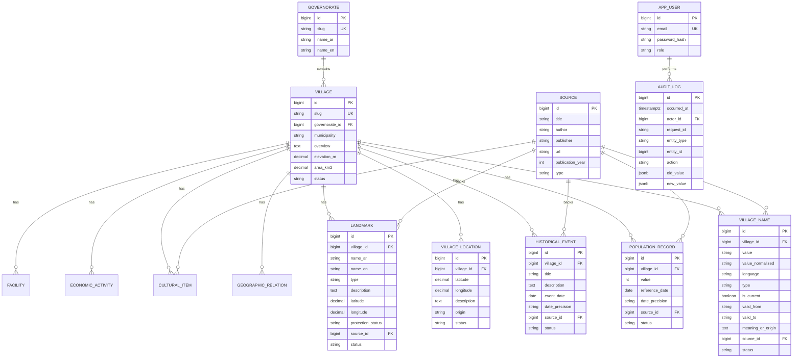

# Qaryati: Starter Guide

Advanced Software Engineering, Fall 2026. Team of 4. Stack: Node.js + TypeScript + Express + PostgreSQL + Docker.

This file is the working blueprint: what we are building, the decisions already made, the ones still open, and what each person does first. Treat it as a draft. When the team changes a decision, update this file **and** write an ADR (section 15).

> **Deadline:** the spec says `01/12/2026`. This guide assumes **1 December 2026** (dd/mm). Confirm with the instructor.

---

## 1. What we are building

**Qaryati is a versioned REST API that serves structured, sourced, reviewed information about Palestinian villages.**

- A wiki-style knowledge base fed by the community, exposed **only as an API** (no website).
- Consumers are **programmers** who need a trustworthy reference for a village's names, location, population history, history, landmarks, and economy.
- The differentiator is **trust**: every important fact has a source, a review status, timestamps, and an audit trail. Nothing public is unreviewed, and nothing is silently overwritten.

### In scope
Village identity and names, geography and location, population history, history/events, landmarks and heritage, culture, agriculture and economy, supporting facilities, sources, roles, review workflow, audit log, one external API integration, caching, load testing, documentation, Docker deployment.

### Out of scope (do not build)
Frontend/UI, municipal complaints or service management, microservices, maps UI, notifications, anything that adds features but not engineering quality. The spec says quality over quantity.

### The one-sentence pitch
> A versioned REST API for Palestinian village knowledge, where every fact has a source, a verification status, and an audit trail.

---

## 2. Decisions and open items

| Area | Decision | Status |
|---|---|---|
| Language / runtime | TypeScript (strict) on Node.js (current LTS) | Decided |
| Web framework | Express 5 (handles async errors natively) | Decided |
| Unit tests | Jasmine (+ Supertest for HTTP integration tests) | Decided |
| Database | PostgreSQL 17 | Proposed |
| Architecture | Modular monolith, layered inside each module | Proposed (ADR-002) |
| ORM | **Prisma** (schema-first, migrations, `$queryRaw`, `$transaction`) or TypeORM | **Open. Decide by end of week 1 (ADR-005)** |
| Validation | Zod (one schema gives validation + TS types) | Proposed |
| Logging | pino + pino-http, request ID via `AsyncLocalStorage` | Proposed |
| Auth | JWT access token + rotating refresh token, argon2id hashing | Proposed |
| Cache | In-memory LRU first, behind a `Cache` interface; Redis if time allows | **Open (ADR-006)** |
| External API | OpenStreetMap Nominatim behind a `GeocodingProvider` interface | Proposed |
| API docs | OpenAPI spec imported into API-Dog | Proposed |
| Load testing | k6 | Decided by spec |
| CI | GitHub Actions | Proposed |

---

## 3. Domain model

### 3.1 Core idea: every fact has a status

All data that a contributor can add (villages, names, locations, population, events, landmarks, and so on) is a **fact row** with a review status.

| Status | Meaning | Visible in public API? |
|---|---|---|
| `proposed` | Submitted, waiting for review | No (author and reviewers only) |
| `verified` | Approved by a reviewer | **Yes** |
| `disputed` | Conflicts with another fact or source; needs attention | Optional flag; hidden by default |
| `rejected` | Reviewer declined it (kept for history) | No |
| `superseded` | Replaced by a newer verified row | No (visible in history endpoints) |

**Transitions**

```
proposed  -> verified | rejected | disputed
disputed  -> verified | rejected
verified  -> superseded (when its replacement is verified) | disputed
```

**Editing a verified fact never overwrites it.** The edit creates a *new* row with `status = proposed` and `supersedes_id = <old row>`. The old row stays live until the new one is verified, at which point the old becomes `superseded` (in the same transaction).

**Conflicting data** (two sources give different population for the same year) is stored as two rows. Both are kept, a reviewer marks one `verified` and the other `disputed` or `rejected`, and the reviewer's note is recorded. This is our answer to "strategy for conflicting or incomplete data".

### 3.2 Two kinds of time (never mix them)

| Kind | Column examples | Meaning |
|---|---|---|
| **Reference time** | `reference_date`, `valid_from`, `valid_to`, `event_date` | When the fact was true |
| **System time** | `created_at`, `updated_at`, `reviewed_at` | When we recorded/changed it |

Historical dates are often approximate, so use a `date_precision` column (`year`, `month`, `day`, `decade`, `century`) instead of forcing a full date.

### 3.3 Roles

| Role | Can do |
|---|---|
| anonymous | Read `verified` data |
| `contributor` | Everything above + create facts (as `proposed`), edit or withdraw their own `proposed` facts, propose edits to verified facts, see own submissions |
| `reviewer` | Everything above + see all statuses, verify / reject / dispute, read the audit log |
| `admin` | Everything above + soft-delete, manage users and roles |

Rules:
- New registrations start as `contributor`. Only an admin promotes users.
- **Four-eyes rule:** a user cannot verify their own submission.
- The first admin is created by a seed script from environment variables, never hard-coded.

---

## 4. Database

### 4.1 ERD



`CULTURAL_ITEM`, `ECONOMIC_ACTIVITY`, `FACILITY`, and `GEOGRAPHIC_RELATION` follow the same fact pattern (see 4.2) and are omitted from the diagram body only to keep it readable.

### 4.2 Tables and columns

**Common columns on every fact table** (`villages`, `village_names`, `village_locations`, `geographic_relations`, `population_records`, `historical_events`, `landmarks`, `cultural_items`, `economic_activities`, `facilities`):

```
id                BIGINT GENERATED ALWAYS AS IDENTITY PRIMARY KEY
status            TEXT NOT NULL DEFAULT 'proposed'   -- proposed|verified|disputed|rejected|superseded
supersedes_id     BIGINT NULL REFERENCES <same table>(id)
source_id         BIGINT NULL REFERENCES sources(id) -- NOT NULL for population and history
created_by        BIGINT NOT NULL REFERENCES app_users(id)
reviewed_by       BIGINT NULL REFERENCES app_users(id)
reviewed_at       TIMESTAMPTZ NULL
review_note       TEXT NULL
created_at        TIMESTAMPTZ NOT NULL DEFAULT now()
updated_at        TIMESTAMPTZ NOT NULL DEFAULT now()
deleted_at        TIMESTAMPTZ NULL                   -- soft delete
```

Use CHECK constraints or enums for `status`, `language`, and the `type` columns.

**Table specifics**

| Table | Specific columns and notes |
|---|---|
| `governorates` | `slug`, `name_ar`, `name_en`. Seeded, rarely changes. |
| `villages` | `slug` (unique, English transliteration, e.g. `beita`; disambiguate duplicates with the governorate), `governorate_id`, `municipality`, `overview`, `elevation_m`, `area_km2`. |
| `village_names` | `value`, `value_normalized` (for search), `language` (`ar`/`en`), `type` (`official`, `alternative`, `transliteration`, `former`, `historical`), `is_current`, `valid_from`, `valid_to`, `meaning_or_origin`. |
| `village_locations` | `latitude`, `longitude`, `description`, `origin` (`manual` or `geocoder`). Several rows allowed (proposed/disputed); at most one `verified`. |
| `geographic_relations` | `village_id`, `place_name_ar`, `place_name_en`, `place_type` (`village`, `city`, `municipality`), `related_village_id` (nullable), `relation` (`nearby`, `part_of`, `administered_by`). Curated relations only. *Distance-based "nearby villages" are computed, not stored (4.4).* |
| `population_records` | `value` (int), `reference_date`, `date_precision`. `source_id` required. |
| `historical_events` | `title`, `description`, `event_date`, `date_precision`. `source_id` required. |
| `landmarks` | `name_ar`, `name_en`, `type` (`archaeological`, `spring`, `religious`, `traditional_building`, `viewpoint`, `other`), `description`, `latitude`, `longitude`, `protection_status` (e.g. `none`, `national`, `unesco_listed`, `unesco_tentative`). |
| `cultural_items` | `category` (`craft`, `food`, `practice`, `other`), `name_ar`, `name_en`, `description`. |
| `economic_activities` | `category` (`crop`, `craft`, `industry`, `livestock`, `other`), `name_ar`, `name_en`, `description`. |
| `facilities` | `type` (`school`, `clinic`, `library`, `community_center`, `park`, `sports`, `other`), `name_ar`, `name_en`. Supporting context only. |
| `sources` | `title`, `author`, `publisher`, `url`, `publication_year`, `type` (`book`, `census`, `article`, `archive`, `website`, `oral_history`), `created_by`. Not itself reviewed as a fact, but audited. |
| `app_users` | `email` (unique), `password_hash`, `role`, `is_active`, `created_at`. |
| `refresh_tokens` | `user_id`, `token_hash`, `expires_at`, `revoked_at`, `replaced_by`. Store only hashes. |
| `audit_log` | See 4.3. |

### 4.3 Audit log (append-only, enforced by the database)

```sql
CREATE TABLE audit_log (
  id           BIGINT GENERATED ALWAYS AS IDENTITY PRIMARY KEY,
  occurred_at  TIMESTAMPTZ NOT NULL DEFAULT now(),
  actor_id     BIGINT REFERENCES app_users(id),
  request_id   TEXT,
  entity_type  TEXT NOT NULL,
  entity_id    BIGINT NOT NULL,
  action       TEXT NOT NULL,      -- CREATE | UPDATE | REVIEW | DELETE | LOGIN_FAILED ...
  old_value    JSONB,
  new_value    JSONB
);

CREATE INDEX audit_entity_idx ON audit_log (entity_type, entity_id);
CREATE INDEX audit_actor_idx  ON audit_log (actor_id, occurred_at DESC);

CREATE FUNCTION forbid_audit_mutation() RETURNS trigger AS $$
BEGIN
  RAISE EXCEPTION 'audit_log is append-only';
END;
$$ LANGUAGE plpgsql;

CREATE TRIGGER audit_no_update_delete
  BEFORE UPDATE OR DELETE ON audit_log
  FOR EACH ROW EXECUTE FUNCTION forbid_audit_mutation();

CREATE TRIGGER audit_no_truncate
  BEFORE TRUNCATE ON audit_log
  FOR EACH STATEMENT EXECUTE FUNCTION forbid_audit_mutation();
```

Extra hardening: run the app with a DB role that has only `INSERT, SELECT` on `audit_log`. Optional stretch: hash chaining (`row_hash = sha256(prev_hash || row content)`).

**The audit row is written in the same transaction as the change.** Both succeed or both roll back.

### 4.4 Required raw SQL cases (the rest uses the ORM)

Document *why* each one is raw in an ADR (ORM cannot express it well or produces N+1 or slow queries).

1. **Nearby villages** (distance query):

```sql
SELECT v.slug,
       6371 * acos(LEAST(1,
         cos(radians($1)) * cos(radians(l.latitude)) * cos(radians(l.longitude) - radians($2))
       + sin(radians($1)) * sin(radians(l.latitude)))) AS distance_km
FROM villages v
JOIN village_locations l
  ON l.village_id = v.id AND l.status = 'verified' AND l.deleted_at IS NULL
WHERE v.deleted_at IS NULL AND v.status = 'verified' AND v.id <> $3
  AND l.latitude BETWEEN $1 - ($4 / 111.0) AND $1 + ($4 / 111.0)   -- cheap bounding-box prefilter
ORDER BY distance_km
LIMIT $5;
```
(PostGIS `ST_DWithin` is the upgrade path if we want it.)

2. **Village search** with name matching across all names (Arabic, English, former), fuzzy match with `pg_trgm`, filters, sort, pagination. Needs `CREATE EXTENSION pg_trgm;`.
3. **Population growth per governorate** (aggregate report using window functions or `LATERAL` for "latest verified population per village"). This is also needed to sort villages by population.

Always use parameterized queries (`$1`, `$2`, or the ORM's tagged template). Never concatenate strings.

### 4.5 Integrity rules the DB enforces itself

```sql
-- one verified location per village
CREATE UNIQUE INDEX one_verified_location ON village_locations (village_id)
  WHERE status = 'verified' AND deleted_at IS NULL;

-- one current official name per language per village
CREATE UNIQUE INDEX one_current_official_name ON village_names (village_id, language)
  WHERE is_current AND type = 'official' AND status = 'verified' AND deleted_at IS NULL;

-- no duplicate population record for the same village, date, and source
CREATE UNIQUE INDEX uniq_population ON population_records (village_id, reference_date, source_id)
  WHERE deleted_at IS NULL AND status NOT IN ('rejected', 'superseded');
```

### 4.6 Starting index plan (adjust after load testing, not before)

- `villages(slug)` unique, `villages(governorate_id)`, `villages(status)`.
- `village_names(village_id)`, GIN trigram index on `village_names(value_normalized)`.
- `population_records(village_id, reference_date DESC)` filtered on `status = 'verified'`.
- `village_locations(latitude, longitude)`.
- `audit_log(entity_type, entity_id)` and `audit_log(actor_id, occurred_at DESC)`.
- Foreign keys used in joins.

**Arabic search normalization:** before storing and before searching, normalize text: strip diacritics (tashkeel) and tatweel, unify `أ إ آ` to `ا`, unify `ى` to `ي`, and trim spaces. Store the result in `value_normalized`. Put this in one pure, well-tested function.

### 4.7 Migrations and seed data

- Migrations are versioned files in the repo, run automatically in Docker startup (or via one command). Never edit an applied migration.
- Seed scripts: (1) governorates, (2) first admin from env, (3) **demo data**: 10 to 20 real villages with real sourced data (start with your region), (4) a **load-test generator** creating 1,000 to 10,000 synthetic villages for k6.

---

## 5. Architecture

**Style: modular monolith, layered inside each module.** One deployable app, split into modules with clear boundaries. Microservices would add operational cost without helping the grade.

### 5.1 Layers and dependency direction

```
HTTP request
  -> routes -> controller      (parse/validate input, call service, shape response. No business logic.)
             -> service        (business rules, transactions, authorization checks, audit calls)
             -> repository     (all DB access; interface + implementation)
             -> database
```

Rules (put these in the README, reviewers enforce them in PRs):

1. Dependencies point **inward**: controller -> service -> repository interface.
2. Services never import `express`, Prisma/TypeORM types, or `process.env`.
3. Repositories are **interfaces**; the ORM implementation is a separate file. Unit tests use fakes.
4. Pure domain rules (validation, status transitions, name normalization) live in plain functions with no I/O.
5. Modules talk to each other only through the other module's **service**, never its repository or tables.
6. Time comes from an injected `Clock`, randomness/IDs from injected functions, so tests are deterministic.
7. Config is read once at startup, validated with Zod, and passed in. No `process.env` scattered around.
8. Wire everything in one **composition root** (`src/container.ts`).

### 5.2 Folder structure

```
qaryati/
  src/
    app.ts                     # builds the Express app (no listen)
    server.ts                  # starts HTTP server, graceful shutdown
    container.ts               # composition root
    config/                    # env schema (Zod), config object
    shared/
      errors/                  # AppError, NotFoundError, ValidationError, ConflictError ...
      http/                    # error handler, request-id, pagination helper, async wrapper
      logging/                 # pino setup, redaction, request context
      db/                      # ORM client, UnitOfWork (transactions)
      time/                    # Clock
      cache/                   # Cache interface + in-memory implementation
    modules/
      auth/                    # register, login, refresh, RBAC middleware
      audit/                   # AuditService (write-only) + read endpoint
      verification/            # status transitions shared by all fact modules (review workflow)
      sources/
      villages/                # villages, names, locations, relations, search, nearby
      population/
      history/                 # historical events
      heritage/                # landmarks, cultural items
      economy/                 # economic activities, facilities
    integrations/
      geocoding/
        geocoding-provider.ts  # the interface + domain types
        nominatim.provider.ts  # the adapter
        fake.provider.ts       # for tests
  prisma/ (or migrations/)     # schema + migrations
  seed/
  test/
    integration/
    load/                      # k6 scripts
  docs/
    adr/
  .github/
    workflows/ci.yml
    pull_request_template.md
  docker-compose.yml
  Dockerfile
  .env.example
```

**Module layout** (same for every module):

```
modules/population/
  population.routes.ts
  population.controller.ts
  population.service.ts
  population.service.spec.ts
  population.repository.ts          # interface
  population.prisma-repository.ts   # implementation
  population.schemas.ts             # Zod request/response DTOs
  population.mapper.ts              # DB row -> response DTO
  population.rules.ts               # pure validation rules
  population.rules.spec.ts
```

Guideline: **don't build a generic abstraction until the third repetition.** The fact modules will look similar; copy the reference module's pattern first, extract shared code only when the duplication is real.

### 5.3 Transaction boundaries

Use a `UnitOfWork.run(async (tx) => { ... })` helper. Repositories accept an optional `tx`. The service decides where the transaction starts and ends.

| Operation | Must be atomic |
|---|---|
| Create village + primary names + location | All rows or none |
| Create/update any fact | The fact row + its audit row |
| Review a fact (verify) | Status change + `superseded` update of the old row + audit row |
| Refresh token rotation | Revoke old + insert new |

External HTTP calls (geocoding) happen **outside** the transaction, never while holding a DB transaction open.

---

## 6. REST API design

### 6.1 Conventions

- Base path `/api/v1`. Breaking changes go to `/api/v2`; additive changes stay in v1.
- Plural nouns, kebab-case URLs, `camelCase` JSON, `snake_case` DB columns.
- **Nested for creating and listing** under a village, **flat for item operations**: `POST /villages/{slug}/population`, `PATCH /population/{id}`.
- Village URLs use the `slug`; other resources use numeric IDs.
- `PATCH` for partial update. `PUT` only if we implement full replacement (we probably won't).
- Dates in ISO 8601. Times in UTC.
- Every response carries an `X-Request-Id` header.
- List responses: `{ "data": [...], "meta": { "page", "pageSize", "totalItems", "totalPages" } }`.
- Single responses: `{ "data": {...} }`.
- Pagination: `page` (default 1) and `pageSize` (default 20, max 100). Offset pagination for simplicity. Note the trade-off (deep pages are slow; cursor pagination is the alternative).
- Sorting: `sort=name|population|updatedAt`, `order=asc|desc`, **whitelisted** fields only.
- Filtering: `q`, `governorate`, `status` (reviewers only), `minPopulation`, `maxPopulation`, and similar.
- Expanding: `GET /villages/{slug}?include=population,events,landmarks` (default profile stays light).

### 6.2 Endpoints (first draft)

| Area | Endpoints |
|---|---|
| Auth | `POST /auth/register`, `POST /auth/login`, `POST /auth/refresh`, `POST /auth/logout`, `GET /auth/me` |
| Villages | `GET /villages`, `POST /villages`, `GET /villages/{slug}`, `PATCH /villages/{slug}`, `DELETE /villages/{slug}` (admin, soft) |
| Names | `GET/POST /villages/{slug}/names`, `PATCH/DELETE /names/{id}` |
| Location | `GET/POST /villages/{slug}/locations`, `PATCH /locations/{id}`, `POST /villages/{slug}/locations/suggest` (calls geocoder, creates a *proposed* location) |
| Geography | `GET /villages/{slug}/nearby?radiusKm=10&limit=10`, `GET/POST /villages/{slug}/relations` |
| Population | `GET/POST /villages/{slug}/population`, `PATCH/DELETE /population/{id}` |
| History | `GET/POST /villages/{slug}/events`, `PATCH/DELETE /events/{id}` |
| Landmarks | `GET/POST /villages/{slug}/landmarks`, `PATCH/DELETE /landmarks/{id}` |
| Culture | `GET/POST /villages/{slug}/cultural-items`, `PATCH/DELETE /cultural-items/{id}` |
| Economy | `GET/POST /villages/{slug}/economic-activities`, `PATCH/DELETE /economic-activities/{id}` |
| Facilities | `GET/POST /villages/{slug}/facilities`, `PATCH/DELETE /facilities/{id}` |
| Sources | `GET/POST /sources`, `GET/PATCH /sources/{id}` |
| Review | `GET /review-queue?type=&status=proposed`, `POST /{resource}/{id}/review` with body `{ "decision": "verified" \| "rejected" \| "disputed", "note": "..." }` |
| Audit | `GET /audit-log?entityType=&entityId=&actorId=&from=&to=` (reviewer/admin) |
| Users | `GET /users`, `PATCH /users/{id}/role` (admin) |
| Ops | `GET /health` (liveness), `GET /ready` (checks DB), both outside `/api/v1` |

### 6.3 HTTP status codes

| Code | Use |
|---|---|
| 200 | OK |
| 201 | Created (with `Location` header) |
| 204 | Deleted / no content |
| 400 | Malformed request or schema validation failure |
| 401 | Missing or invalid token |
| 403 | Authenticated but role/ownership not allowed |
| 404 | Not found (also for hidden non-verified data to non-privileged users) |
| 409 | Conflict (duplicate, invalid status transition) |
| 422 | Valid shape but violates a domain rule (e.g. population date in the future) |
| 429 | Rate limit exceeded |
| 500 | Unexpected error (never leak internals) |
| 502 / 503 / 504 | External provider failed, unavailable, or timed out |

### 6.4 Error format (one format everywhere)

```json
{
  "error": {
    "code": "VALIDATION_ERROR",
    "message": "Request validation failed",
    "details": [
      { "field": "referenceDate", "issue": "must not be in the future" }
    ],
    "requestId": "6f0c2a1e-5d1c-4c0b-9d0e-1b2c3d4e5f60",
    "timestamp": "2026-10-12T14:03:11.000Z"
  }
}
```

Error codes (stable, machine-readable): `VALIDATION_ERROR`, `DOMAIN_RULE_VIOLATION`, `UNAUTHENTICATED`, `FORBIDDEN`, `NOT_FOUND`, `CONFLICT`, `INVALID_STATUS_TRANSITION`, `RATE_LIMITED`, `EXTERNAL_SERVICE_UNAVAILABLE`, `INTERNAL_ERROR`.

Implementation: services throw typed `AppError` subclasses; **one global error handler** maps them to this format and logs unexpected ones with the request ID. Unknown errors become `INTERNAL_ERROR` with no stack trace in the response.

### 6.5 Example: village profile response (illustrative data, not real)

```json
{
  "data": {
    "slug": "example-village",
    "name": { "ar": "قرية المثال", "en": "Example Village" },
    "names": [
      { "id": 1, "value": "قرية المثال", "language": "ar", "type": "official", "isCurrent": true },
      { "id": 2, "value": "Example Village", "language": "en", "type": "official", "isCurrent": true },
      { "id": 3, "value": "Qaryat al-Mithal", "language": "en", "type": "transliteration" },
      { "id": 4, "value": "Old Example", "language": "en", "type": "historical",
        "validFrom": "1517", "validTo": "1917",
        "source": { "id": 3, "title": "Example Ottoman Register" } }
    ],
    "meaningOrOrigin": {
      "text": "Documented explanation of the name goes here.",
      "source": { "id": 5, "title": "Example Gazetteer", "publicationYear": 1998 }
    },
    "governorate": { "slug": "example-governorate", "name": { "ar": "...", "en": "..." } },
    "municipality": "Example Municipality",
    "location": { "latitude": 32.0, "longitude": 35.0, "description": "About X km south-west of Y", "elevationM": 500 },
    "nearby": [ { "slug": "another-village", "distanceKm": 3.2 } ],
    "population": {
      "latest": { "value": 1234, "referenceDate": "2017-01-01", "source": { "id": 7, "title": "Example Census 2017" } },
      "historyUrl": "/api/v1/villages/example-village/population"
    },
    "status": "verified",
    "updatedAt": "2026-10-12T14:03:11.000Z"
  }
}
```

### 6.6 Population validation rules (draft, teammate 2 finalizes)

Defined as pure functions in `population.rules.ts`:

1. `value` is an integer > 0 (upper bound configurable).
2. `referenceDate` is not in the future and not before a configured minimum year (default 1500; Ottoman tax registers exist).
3. `sourceId` is required and must exist.
4. No duplicate `(village, referenceDate, source)`.
5. Same village and date with a **different value from a different source** is allowed and flagged as a conflict for the reviewer; do not overwrite.
6. A large jump versus the nearest neighbouring record (default > 50%) returns a **warning** in the response and is shown in the review queue. It is not an error, because real history includes dramatic changes.
7. Only the author (while `proposed`) or a reviewer/admin can modify a record.

---

## 7. Authentication, authorization, and security

- **Passwords:** argon2id (or bcrypt with cost 12+). Never log or return them.
- **Tokens:** access JWT (about 15 min) + refresh token (about 7 days), rotated on use, stored **hashed** in `refresh_tokens`. Logout revokes the refresh token.
- **JWT secret:** from environment, at least 32 random bytes, different per environment.
- **RBAC:** a middleware `requireRole(...)` checks the role; services additionally check **ownership** (e.g. contributors edit only their own proposals) and the four-eyes rule.
- **Rate limiting:** global limit per IP, much stricter on `/auth/login` and `/auth/register` (e.g. 10 per 15 min).
- **Headers/CORS:** `helmet`, CORS with an explicit origin allow-list from config.
- **Input:** Zod validation on every request (body, params, query), request body size limit.
- **SQL:** parameterized queries everywhere, including raw SQL.
- **Errors:** same generic message for wrong email vs wrong password.
- **Secrets:** `.env` is gitignored; `.env.example` lists variable names with fake values; no secrets in Docker images, logs, or Git history. If a secret is ever committed, rotate it (deleting the commit is not enough).
- **Dependencies:** `npm audit` in CI.

---

## 8. External API integration (geocoding)

**Purpose:** given a village name, suggest coordinates (and possibly a location description). Results are **suggestions**: they are saved as `proposed` locations with `origin = 'geocoder'`, and a reviewer decides.

```ts
// integrations/geocoding/geocoding-provider.ts (domain side, knows nothing about any vendor)
export interface GeocodeQuery { text: string; countryCode?: string; limit?: number }
export interface GeocodeResult { latitude: number; longitude: number; displayName: string; confidence?: number }

export interface GeocodingProvider {
  geocode(query: GeocodeQuery): Promise<GeocodeResult[]>;
}
```

The adapter (`NominatimGeocodingProvider`) maps Nominatim's response to `GeocodeResult`. Swapping providers = writing one new adapter and changing one config value (`GEOCODING_PROVIDER`). Services depend only on the interface.

**Robustness rules (document these in the ADR):**

| Concern | Decision |
|---|---|
| Timeout | Hard timeout per request (about 3 to 5 s) with `AbortController` |
| Retries | Up to 2 retries with exponential backoff + jitter, **only** for network errors, 5xx, and 429 (honor `Retry-After`). No retry on 4xx. Geocoding is a read, so retrying is safe. |
| Rate limit | Nominatim's public policy allows about 1 request/second and requires an identifying `User-Agent`; check the current usage policy. Use a small throttle/queue. |
| Caching | Cache results by normalized query with a long TTL. Also reduces load and cost. |
| Failure | Throw `ExternalServiceUnavailableError` -> `503` with code `EXTERNAL_SERVICE_UNAVAILABLE`. The rest of the API keeps working. |
| Optional | Simple circuit breaker (stop calling for N seconds after M consecutive failures). |
| Testing | Unit-test the service with `FakeGeocodingProvider`; test the adapter against mocked HTTP responses (success, timeout, 500, 429, malformed JSON). |

---

## 9. Caching strategy

Behind a `Cache` interface (`get`, `set`, `del`, TTL) so the implementation (in-memory LRU vs Redis) can change.

| Cache | Do not cache |
|---|---|
| Public `GET /villages/{slug}` (verified data), short-medium TTL, invalidated when a related fact is verified | Anything authenticated or per-user |
| Governorates and other near-static lookups | `proposed` data or the review queue |
| Geocoder responses (long TTL) | The audit log |
| Popular search results (very short TTL), *only if load tests show it helps* | Write endpoints |

Decide based on measurement (section 14), not guesses. Write the reasoning in ADR-006.

---

## 10. Configuration, logging, Docker

### 10.1 Configuration

All settings come from environment variables, validated at startup with Zod (**fail fast** if invalid). Three profiles: `development`, `test`, `production`-like (Docker).

`.env.example`:

```
NODE_ENV=development
PORT=3000
DATABASE_URL=postgresql://qaryati:change_me@db:5432/qaryati
JWT_SECRET=change_me_to_a_long_random_string
JWT_ACCESS_TTL=15m
JWT_REFRESH_TTL=7d
CORS_ORIGINS=http://localhost:3000
RATE_LIMIT_WINDOW_MS=60000
RATE_LIMIT_MAX=100
AUTH_RATE_LIMIT_MAX=10
LOG_LEVEL=info
GEOCODING_PROVIDER=nominatim
GEOCODING_BASE_URL=https://nominatim.openstreetmap.org
GEOCODING_USER_AGENT=qaryati-course-project (contact: your-email@example.com)
GEOCODING_TIMEOUT_MS=4000
CACHE_TTL_SECONDS=300
ADMIN_BOOTSTRAP_EMAIL=admin@example.com
ADMIN_BOOTSTRAP_PASSWORD=change_me
```

### 10.2 Logging

- pino, JSON output to stdout. Pretty-print only in development.
- Request ID: accept `X-Request-Id` or generate a UUID, store in `AsyncLocalStorage`, include it in every log line, the error response, and audit rows.
- Levels: `error` (unexpected failures), `warn` (validation-heavy abuse, retries, degraded external service), `info` (request summaries, startup), `debug` (dev only).
- **Redact:** `authorization` header, `password`, `token`, `refreshToken`, cookies. Do not log request bodies by default.
- Keep application logs (debugging) separate from the audit log (accountability).

### 10.3 Docker

`Dockerfile` (multi-stage; use the current Node LTS image):

```dockerfile
FROM node:22-alpine AS build
WORKDIR /app
COPY package*.json ./
RUN npm ci
COPY . .
RUN npm run build

FROM node:22-alpine
WORKDIR /app
ENV NODE_ENV=production
COPY package*.json ./
RUN npm ci --omit=dev
COPY --from=build /app/dist ./dist
COPY --from=build /app/prisma ./prisma
USER node
EXPOSE 3000
CMD ["node", "dist/server.js"]
```

`docker-compose.yml`:

```yaml
services:
  db:
    image: postgres:17-alpine
    environment:
      POSTGRES_USER: qaryati
      POSTGRES_PASSWORD: ${DB_PASSWORD}
      POSTGRES_DB: qaryati
    volumes:
      - pgdata:/var/lib/postgresql/data
    healthcheck:
      test: ["CMD-SHELL", "pg_isready -U qaryati -d qaryati"]
      interval: 5s
      timeout: 3s
      retries: 10

  api:
    build: .
    env_file: .env
    depends_on:
      db:
        condition: service_healthy
    ports:
      - "3000:3000"

  # redis:            # add later if the caching ADR chooses it
  #   image: redis:7-alpine

volumes:
  pgdata:
```

Goal: `cp .env.example .env && docker compose up --build` gives a working system with migrations applied. Also provide a way to run the test database (a second compose file or profile).

---

## 11. Testing strategy

| Level | What | Tools | DB |
|---|---|---|---|
| Unit | Services (with fake repositories, fake `Clock`, fake provider), pure rule functions, mappers, name normalization | Jasmine (`createSpyObj` or hand-written fakes) | None |
| Integration | Real HTTP through the app: auth, RBAC, validation errors, pagination/sort/filter, review workflow, audit rows written, transactions roll back | Jasmine + Supertest | Real PostgreSQL in Docker, migrations applied |
| Adapter | Geocoding adapter against mocked HTTP: success, timeout, 429/500 retry, bad JSON | Jasmine + a mocked `fetch` | None |
| Load | See section 14 | k6 | Docker stack |

Rules:
- Mock at **boundaries** (repositories, external provider, clock), never the unit under test.
- Test data via small **builders/factories** (`aVillage({...})`), not copy-pasted literals. Separate from demo seed data.
- Each integration test starts from a known state (truncate tables or roll back a transaction).
- `*.spec.ts` sits next to the code for unit tests; integration tests live in `test/integration`.
- Test the **failure paths** as much as the happy paths: invalid input, forbidden roles, duplicates, invalid status transitions, external failure.
- Coverage is a signal, not a goal. Aim for high coverage of services and rules; report it in CI.

**Jasmine + TypeScript setup** (verify on day 1, since this is where setup problems usually appear):

```json
// jasmine.json
{
  "spec_dir": "src",
  "spec_files": ["**/*.spec.ts"],
  "requires": ["ts-node/register"],
  "random": true
}
```

```jsonc
// tsconfig.json (essentials)
{
  "compilerOptions": {
    "target": "ES2022",
    "module": "commonjs",
    "strict": true,
    "noUncheckedIndexedAccess": true,
    "esModuleInterop": true,
    "skipLibCheck": true,
    "outDir": "dist",
    "rootDir": "."
  }
}
```

Suggested `package.json` scripts: `dev`, `build`, `start`, `lint`, `typecheck` (`tsc --noEmit`), `test` (unit), `test:integration`, `db:migrate`, `db:seed`.

---

## 12. Git workflow and pull requests

The "PR handler" is **GitHub configuration + a template + CI**, not code.

**Repository settings**
- One repo. Protect `main`: no direct pushes, PR required, at least 1 approval, CI must pass, branch up to date, no force-push.
- Squash-merge to keep history clean.
- Use Issues (one per task) and a Projects board: `To do / In progress / In review / Done`. Label by module.

**Branches:** `feature/<module>-<short-description>`, `fix/...`, `docs/...`, `chore/...`.

**Commits:** small and focused, imperative, with a type prefix:
```
feat(population): reject future reference dates
fix(auth): revoke refresh token on logout
test(villages): cover slug collision
docs(adr): add ADR-003 conflict strategy
```

**Rules:** every member commits through PRs; PRs stay small (aim for under about 400 changed lines); nobody merges their own PR without a review; never commit `.env`, keys, dumps, or `node_modules`.

`.github/pull_request_template.md`:

```markdown
## What changed
<!-- one or two sentences -->

## Why
<!-- link the issue: Closes #123 -->

## Design decisions
<!-- anything a reviewer should know: trade-offs, alternatives rejected, ADR link -->

## How it was tested
- [ ] Unit tests added/updated
- [ ] Integration tests added/updated (if endpoints or DB changed)
- [ ] Manually verified (describe)

## Checklist
- [ ] Follows the layer rules (no business logic in controllers, services don't import framework/ORM types)
- [ ] Input validated, errors use the standard error format
- [ ] Audit entry written for state-changing operations
- [ ] Migration included and reversible (if schema changed)
- [ ] No secrets or debug code committed
- [ ] Docs / OpenAPI updated
```

`.github/workflows/ci.yml` (sketch): on pull request -> checkout, setup Node, `npm ci`, lint, `tsc --noEmit`, start a Postgres service container, run migrations, run unit + integration tests, `npm audit --audit-level=high`.

**Definition of Done** for any task: merged via reviewed PR, tests included, OpenAPI updated, docs/ADR updated if a decision was made, CI green.

---

## 13. Team split and timeline

### 13.1 Ownership

| Person | Owns |
|---|---|
| **Lead (you)** | Repo and process setup, CI, Docker, skeleton, config, logging, error handling, migrations tooling, `auth`, `audit`, `verification` (status workflow), PR reviews, architecture docs, ADR-001/002/004 |
| **Teammate 1** | `villages` module (villages, names, locations, relations), search/filter/sort/pagination, nearby-villages raw SQL, Arabic normalization |
| **Teammate 2** | `population` (with validation rules), `history`, `sources`, provenance rules and conflict handling |
| **Teammate 3** | `heritage` (landmarks, cultural items), `economy` (economic activities, facilities), geocoding integration + cache |
| **Everyone** | Unit and integration tests for their own module, OpenAPI for their endpoints, own docs section, own ADR |
| **Two people, late** | k6 scenarios, baseline, optimization, performance report (suggest Teammate 3 + Teammate 1) |

Shared components owned by the lead (`AuditService`, `VerificationService`, `UnitOfWork`, error classes, auth middleware) have **stable interfaces published early**. Teammates call them; they do not reimplement them.

### 13.2 Timeline (about 9 weeks, 1 Oct to 1 Dec)

| Week | Dates | Goal |
|---|---|---|
| 1 | Oct 1-7 | Repo, rules, Docker skeleton, decisions (ORM, cache), ERD agreed by everyone. Teammates: set up the stack, learn TS/Express basics, draft the ERD and endpoint list for their module. |
| 2 | Oct 8-14 | Migrations + base schema, auth/RBAC, audit, error handling, logging, **reference module (villages) complete with tests**. Team review session on the pattern. |
| 3-5 | Oct 15-Nov 4 | Feature modules in parallel, each with unit tests and PRs. Weekly integration check. Milestone at end of week 5: all modules merged, full review workflow works end to end. |
| 6 | Nov 5-11 | Geocoding integration, caching, integration tests, seed with real demo data. |
| 7 | Nov 12-18 | k6 baseline -> find bottleneck -> one evidence-based fix -> re-test. |
| 8 | Nov 19-25 | Documentation, ADRs, ERD final, OpenAPI export, cleanup, README run-through on a clean machine. |
| 9 | Nov 26-Dec 1 | Buffer, final testing, rehearse the defense (each person explains their module and decisions). |

---

## 14. Performance and load testing plan

**Scenarios (k6):**
1. **Read-heavy:** village search/listing with filters + village details (e.g. 90% of traffic).
2. **Write-oriented:** login once (in `setup()`), then authenticated `POST` population records and `PATCH` updates.

**Data:** 1,000 to 10,000 synthetic villages with related rows so the numbers mean something.

**Metrics to record:** average response time, p95 latency, throughput (requests/s), error rate, and the identified bottleneck. Also watch container CPU/memory (`docker stats`).

**Process (this is what gets graded):**
1. Build the feature straightforwardly. Do not pre-optimize.
2. Run the baseline. Record numbers.
3. Diagnose (`EXPLAIN ANALYZE`, query logging, N+1 detection, profiling).
4. Apply **one** targeted change (candidates: missing/wrong index, N+1 in profile assembly, missing cache, unbounded queries, connection pool size).
5. Re-run under identical conditions. Record before/after.
6. Write it up: limitation observed, likely root cause, change, before/after table.

Save scripts in `test/load/` and results in `docs/performance.md`.

k6 skeleton:

```js
import http from 'k6/http';
import { check, sleep } from 'k6';

export const options = {
  stages: [{ duration: '30s', target: 20 }, { duration: '1m', target: 50 }, { duration: '30s', target: 0 }],
  thresholds: { http_req_failed: ['rate<0.01'], http_req_duration: ['p(95)<500'] },
};

export default function () {
  const res = http.get(`${__ENV.BASE_URL}/api/v1/villages?q=beit&page=1&pageSize=20`);
  check(res, { 'status is 200': (r) => r.status === 200 });
  sleep(1);
}
```

---

## 15. Documentation and ADRs

**README (or wiki) must contain:** overview and scope, architecture diagram and explanation, ERD and modeling decisions, API conventions and error model, auth and security approach, external API design, performance results, deployment instructions, ADR list.

**API docs:** OpenAPI spec (kept up to date per PR), imported to API-Dog; include the authentication flow, request/response schemas, and error format.

**ADRs** (`docs/adr/000X-title.md`; half a page each: Context, Decision, Alternatives considered, Consequences/trade-offs). The spec needs at least 3; plan for these:

| ADR | Topic |
|---|---|
| 001 | Tech stack (Node/Express/TypeScript, why not NestJS/Spring/Django) |
| 002 | Modular monolith with layered modules, dependency rules |
| 003 | Provenance and conflict strategy (status per fact, supersede, never overwrite) |
| 004 | Append-only audit log enforced by the database |
| 005 | ORM choice and the raw SQL policy |
| 006 | Caching strategy (what is and isn't cached) |
| 007 | Geocoding abstraction and failure handling |

---

## 16. Week 1 checklist (lead)

- [ ] Create the GitHub repo, protect `main`, add PR template, issue templates, Projects board, invite teammates.
- [ ] Commit `.gitignore`, `.env.example`, this guide, and an empty `docs/adr/`.
- [ ] Decide ORM (Prisma vs TypeORM) and cache approach with the team; write ADR-001, 002, 005.
- [ ] Project skeleton: `tsconfig` (strict), ESLint + Prettier, folder layout, config validation, pino logger, request ID middleware, error classes + global handler, async wrapper if needed.
- [ ] `docker-compose.yml` with PostgreSQL, Dockerfile, verify `docker compose up` works on another teammate's machine.
- [ ] Jasmine running one dummy test in CI.
- [ ] Migration tooling working; first migration: users, governorates, sources, audit_log (with triggers).
- [ ] Team session: walk through the ERD, fix column names, and agree on the endpoint list.
- [ ] Give each teammate a first issue (setup + reading + their ERD/endpoint draft).

## 17. Final submission checklist (maps to the grading)

- [ ] **Architecture, modularity, API design (25%):** layers respected, module boundaries, consistent REST, versioned, pagination/filter/sort, one error format.
- [ ] **Process and version control (15%):** feature branches, PRs with context, focused commits, every member visible in history, no secrets.
- [ ] **Database and modeling (15%):** ERD, constraints, indexes with reasons, migrations, ORM + raw SQL cases justified.
- [ ] **Correctness, security, quality (10%):** auth/RBAC, validation, tests, no hard-coded config.
- [ ] **External API (5%):** interface + adapter, timeout, retry rationale, rate limit, cache, graceful failure.
- [ ] **Performance and operations (20%):** k6 read + write scenarios, all five metrics, bottleneck, one measured improvement, logging, Docker one-command startup.
- [ ] **Documentation and decisions (10%):** README/wiki sections, OpenAPI/API-Dog, at least 3 ADRs explaining *why*.
